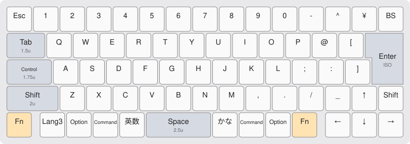
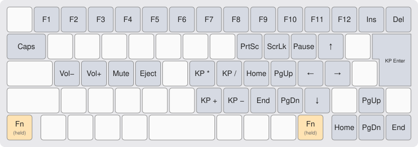

# YM60JIS Trilingual macOS

A hot-swappable 60% mechanical keyboard PCB with a Japanese (JIS) layout, powered by the RP2040 microcontroller. It fits most Poker- and GH60-style 60% cases.

This is a fork of [ymkn/YM60JIS](https://github.com/ymkn/YM60JIS). It changes the bottom row to an HHKB-style row of 1u keys for macOS, with English (英数), Kana (かな) and a third-language key (Lang3).

*Photo of the original YM60JIS. Its bottom row differs from this fork.*

## Changes from the original YM60JIS

- **Bottom row:** all keys are 1u except a 2.5u spacebar (about 46 mm wide, matching the HHKB). A 0.25u gap sits on each side of the modifier block.
  - `Fn` · *0.25u gap* · `Lang3` `Option` `Command` `英数` `Space (2.5u)` `かな` `Command` `Option` `Fn` · *0.25u gap* · `←` `↓` `→`
- **Key mapping follows the HHKB:**
  - Control sits on the Caps Lock position.
  - The Fn layer follows the HHKB Fn layer (see below).
- **Lang3** sends the Grave/Tilde keycode (`KC_GRV`). You can bind it in macOS as the shortcut for switching to a third input source.
- **英数 and かな** send `LANG2` and `LANG1`. macOS recognizes these as the Eisu and Kana keys, the same as on an Apple JIS keyboard.
- **Key count:** the board has 69 keys instead of 67. The two new switches are on matrix positions (4,4) and (4,7).

> [!IMPORTANT]
> The firmware and Vial definition are updated. The KiCAD schematic, PCB and plate are being updated for the new bottom row.
> The files under `KiCAD/*/production/` and the prebuilt `firmware/QMK/ymkn_ym60jis_vial.uf2` are still for the original YM60JIS layout. Don't order them for this layout, and don't flash that `.uf2`.

## Default Layout / Key Mapping

Customize the key mapping with the [Vial](https://get.vial.today/) configurator.

### Base layer

### Fn layer (hold either Fn key)

| Fn + | Sends |
|---|---|
| `1`–`0`, `-`, `^` | F1–F12 |
| `¥` / `BS` | Insert / Delete |
| `Tab` | Caps Lock |
| `I` / `O` / `P` | Print Screen / Scroll Lock / Pause |
| `@` / `;` / `:` / `/` | ↑ / ← / → / ↓ |
| `K` / `L` / `,` / `.` | Home / Page Up / End / Page Down |
| `A` / `S` / `D` / `F` | Volume Down / Volume Up / Mute / Eject |
| `H` / `J` / `N` / `M` | Keypad `*` / `/` / `+` / `-` |
| `Enter` | Keypad Enter |
| `↑` / `←` / `↓` / `→` | Page Up / Home / Page Down / End |

## Specification

- Supports Cherry MX-style switches
- USB Type-C connector (USB 2.0)
- Hot-swap sockets for mechanical switches
- 69 keys, JIS layout with ISO Enter and an HHKB-style bottom row
- Dimensions: 285 × 94.6 × 1.6 mm (W × H × D)
- Compatible with most 60% keyboard cases
  - Note: the center and bottom-right mounting holes are not included

## Build Guide

See [doc/buildguide.md](doc/buildguide.md).

## LICENSE

This project is licensed under the MIT License. See the [LICENSE file](LICENSE) for details.

The original YM60JIS design is by [ymkn](https://github.com/ymkn).
